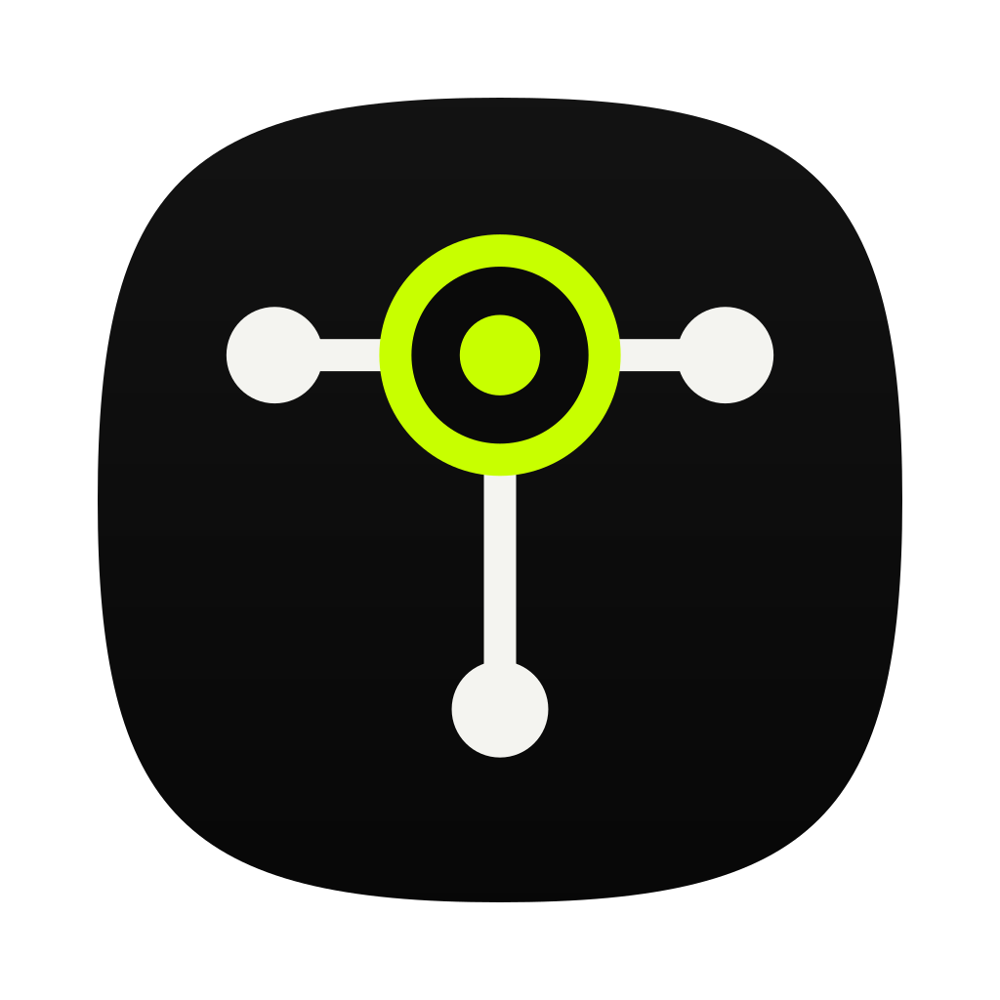

<p align="center">
  
</p>

<h1 align="center">Такт</h1>

<p align="center">
  Desktop app for conducting coding agents.<br>
  One chat with the conductor; under its reply, executors with honest step-by-step progress.
</p>

<p align="center">
  <a href="#english">English</a> · <a href="#ukrainian">Українська</a> · <a href="#russian">Русский</a>
</p>

---

<a id="english"></a>
## English

**Takt** replaces Emdash, Conductor, Vibe Kanban and similar boards with one idea: you talk to a single
conductor agent (Claude Code), and it hands tasks to executors — Codex, Antigravity, Claude.
Every task lives in its own git worktree; every executor gets a card with honest progress:
checked acceptance items from `TASK-<slug>.md`, never a made-up percentage.

### Features

- **Chat · Code · Orchestra.** Conductor chat, built-in terminal, a table of every task across projects.
- **Score view.** Executor cards under the conductor's reply: state, steps, tmux screen, reply and kill buttons.
- **Subscription limits** for Claude, Codex and Antigravity in the header.
- **Access.** MCP servers, CLIs, SSH keys and GitHub accounts in one place. You sign in yourself in your own terminal; the app stores no tokens.
- **Two themes** with contrast ≥ 7:1 and type ≥ 12.5 px, Montserrat and Newsreader.
- **Updates** from GitHub Releases, signature-checked.

### Architecture

<p align="center">
  
</p>

Full spec: [`docs/SPEC.md`](docs/SPEC.md) (Russian). Design system: [`docs/DESIGN.md`](docs/DESIGN.md).

### Install

1. Download `Takt_<version>_universal.dmg` from [Releases](https://github.com/xanymanywka/takt/releases/latest).
2. Drag Takt to Applications. On first launch macOS asks to confirm opening an app from outside the App Store.
3. Run it. The first-start wizard checks `claude`, `codex`, `agy`, `tmux`, `codexbar` and offers to install what is missing.

### Build from source

```bash
pnpm install
pnpm dev          # UI on mocks, http://localhost:1420
pnpm tauri dev    # full app (needs Rust stable)
pnpm tauri build  # .app and .dmg in src-tauri/target/release/bundle
```

### License

[PolyForm Noncommercial 1.0.0](LICENSE): use and modify for yourself, no selling or bundling into
commercial products. Contact the author for commercial use.

### Author

[xanyman.space](https://xanyman.space) · Telegram [@xanymanywka](https://t.me/xanymanywka)

---

<a id="ukrainian"></a>
## Українська

**Такт** замінює Emdash, Conductor, Vibe Kanban і подібні панелі однією ідеєю: ви розмовляєте
з головним агентом (Claude Code, «диригент»), а він роздає задачі виконавцям — Codex, Antigravity, Claude.
Кожна задача живе у своїй git-ворктрі, у кожного виконавця своя картка з чесним прогресом:
відмічені пункти приймання з `TASK-<slug>.md`, а не вигадані відсотки.

### Що всередині

- **Чат · Код · Оркестр.** Чат з диригентом, вбудований термінал, таблиця всіх задач по всіх проєктах.
- **Партитура.** Картки виконавців під реплікою диригента: стан, кроки, екран tmux, кнопки «Відповісти» і «Зняти».
- **Ліміти підписок** Claude, Codex і Antigravity просто в шапці.
- **Доступи.** MCP-сервери, CLI, SSH-ключі, акаунти GitHub — в одному місці. Входи ви робите самі у своєму терміналі, застосунок не зберігає токени.
- **Дві теми** з контрастом ≥ 7:1 і кеглем ≥ 12.5 px, шрифти Montserrat і Newsreader.
- **Оновлення** з GitHub Releases з перевіркою підпису.

### Архітектура

<p align="center">
  
</p>

Докладно: [`docs/SPEC.md`](docs/SPEC.md). Дизайн-система: [`docs/DESIGN.md`](docs/DESIGN.md).

### Встановлення

1. Завантажте `Takt_<версія>_universal.dmg` з [Releases](https://github.com/xanymanywka/takt/releases/latest).
2. Перетягніть «Такт» у «Програми». Під час першого запуску macOS попросить підтвердити відкриття застосунку не з App Store.
3. Запустіть. Майстер першого старту перевірить `claude`, `codex`, `agy`, `tmux`, `codexbar` і запропонує поставити те, чого бракує.

### Збирання з джерел

```bash
pnpm install
pnpm dev          # інтерфейс на моках, http://localhost:1420
pnpm tauri dev    # застосунок цілком (потрібен Rust stable)
pnpm tauri build  # .app і .dmg у src-tauri/target/release/bundle
```

### Ліцензія

[PolyForm Noncommercial 1.0.0](LICENSE): користуватися і змінювати для себе можна, продавати і вбудовувати
в комерційні продукти не можна. Для комерційного використання напишіть автору.

### Автор

[xanyman.space](https://xanyman.space) · Telegram [@xanymanywka](https://t.me/xanymanywka)

---

<a id="russian"></a>
## Русский

**Такт** заменяет Emdash, Conductor, Vibe Kanban и подобные панели одной идеей: вы разговариваете
с главным агентом (Claude Code, «дирижёр»), а он раздаёт задачи исполнителям — Codex, Antigravity, Claude.
Каждая задача живёт в своей git-ворктри, у каждого исполнителя своя карточка с реальным прогрессом:
отмеченные пункты приёмки из `TASK-<slug>.md`, а не выдуманные проценты.

### Что внутри

- **Чат · Код · Оркестр.** Чат с дирижёром, встроенный терминал, таблица всех задач по всем проектам.
- **Партитура.** Карточки исполнителей под репликой дирижёра: состояние, шаги, экран tmux, кнопки «Ответить» и «Снять».
- **Лимиты подписок** Claude, Codex и Antigravity прямо в шапке.
- **Доступы.** MCP-серверы, CLI, SSH-ключи, аккаунты GitHub — в одном месте. Входы вы делаете сами в своём терминале, приложение не хранит токены.
- **Две темы** с контрастом ≥ 7:1 и кеглем ≥ 12.5 px, шрифты Montserrat и Newsreader.
- **Обновления** из GitHub Releases с проверкой подписи.

### Архитектура

<p align="center">
  
</p>

Подробно: [`docs/SPEC.md`](docs/SPEC.md). Дизайн-система: [`docs/DESIGN.md`](docs/DESIGN.md).

### Установка

1. Скачайте `Takt_<версия>_universal.dmg` из [Releases](https://github.com/xanymanywka/takt/releases/latest).
2. Перетащите «Такт» в «Программы». При первом запуске macOS спросит разрешение на открытие приложения не из App Store.
3. Запустите. Мастер первого старта проверит `claude`, `codex`, `agy`, `tmux`, `codexbar` и предложит поставить недостающее.

### Сборка из исходников

```bash
pnpm install
pnpm dev          # интерфейс на моках, http://localhost:1420
pnpm tauri dev    # приложение целиком (нужен Rust stable)
pnpm tauri build  # .app и .dmg в src-tauri/target/release/bundle
```

### Лицензия

[PolyForm Noncommercial 1.0.0](LICENSE): пользоваться и менять для себя можно, продавать и встраивать
в коммерческие продукты нельзя. Для коммерческого использования напишите автору.

### Автор

[xanyman.space](https://xanyman.space) · Telegram [@xanymanywka](https://t.me/xanymanywka)
